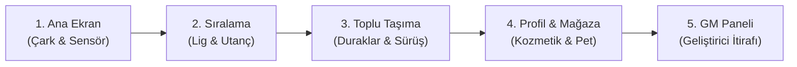
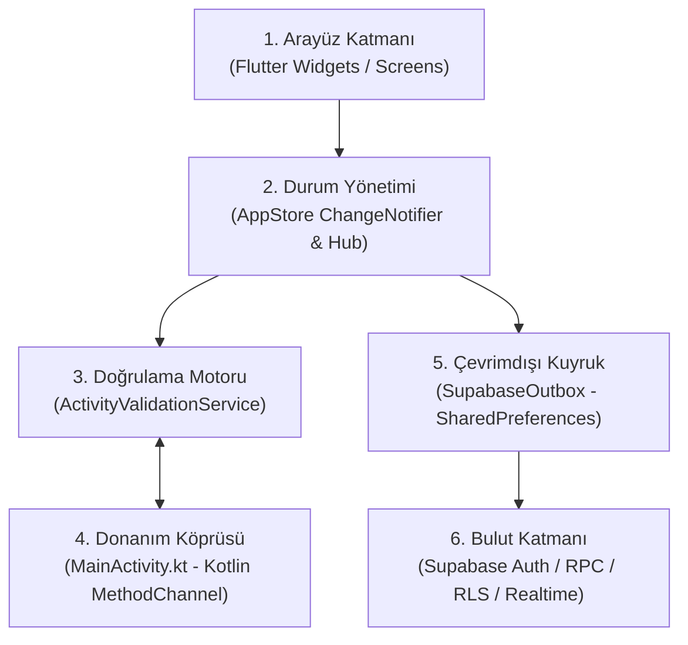
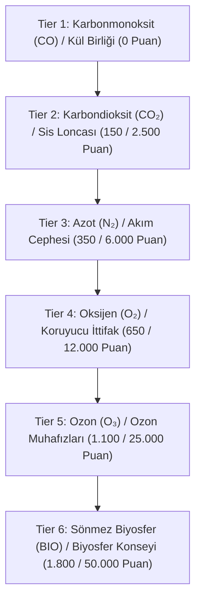
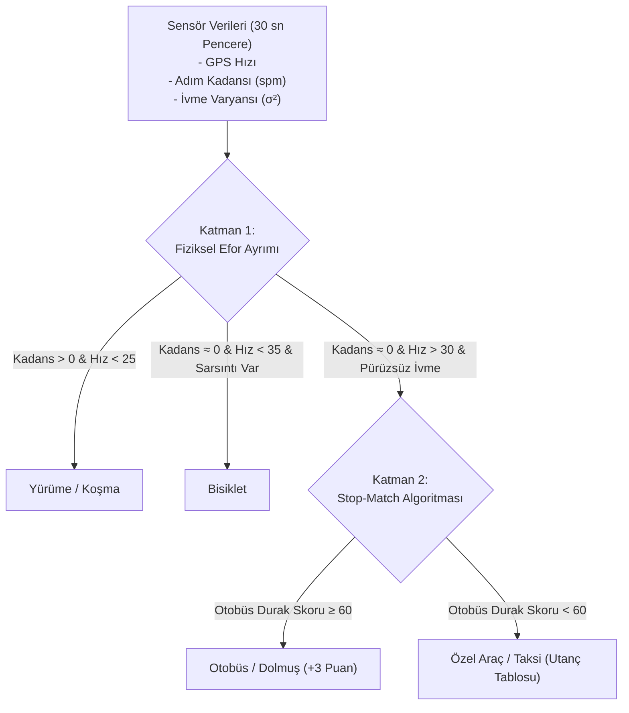

# 🌿 Yeşil Adım (EcoClan) — Sunum ve Jüri Çalışma Rehberi
> **Öğretici, Şeffaf ve Kod Gerçekliğine Dayalı Rehber**  
> **Son Güncelleme:** 31 Ekim 2026 | **Proje Durumu:** Revizyon 03 (Geliştirme Devam Ediyor / `ROOT_DAGITIM_BEKLIYOR`)  
> **Önemli Not:** Bu belge, jüri ve hoca sunumunda projeyi ezbere girmeden, mimariyi ve kodun gerçek sınırlarını bilerek savunabilmeniz için hazırlanmıştır. Gerçekte olmayan hiçbir özellik varmış gibi anlatılmamış; sistemin çalışan yönleri kadar sınırlamaları da şeffafça açıklanmıştır.

---

## 📌 İÇİNDEKİLER
1. [Hızlı Bakış & Proje Kimliği](#1-hızlı-bakış--proje-kimliği)
2. [Süreye Göre Sunum Metinleri (30sn, 3dk, 7–10dk)](#2-süreye-göre-sunum-metinleri)
3. [Kablosuz Telefon Demo Sırası & GM Panelinin Rolü](#3-kablosuz-telefon-demo-sırası--gm-panelinin-rolü)
4. [Başlangıç Seviyesinde Mimari Eğitimi](#4-başlangıç-seviyesinde-mimari-eğitimi)
5. [Gerçek Dosya ve Klasör Haritası](#5-gerçek-dosya-ve-klasör-haritası)
6. [Çalışan Kurallar, Formüller ve Matematik](#6-çalışan-kurallar-formüller-ve-matematik)
7. [Sunucu Mimarisi, Eşitleme ve 3 Cihaz Bulgusu](#7-sunucu-mimarisi-eşitleme-ve-3-cihaz-bulgusu)
8. [Otomatik Ulaşım Tahmini ve Sensör Gerçekleri](#8-otomatik-ulasim-tahmini-ve-sensör-gerçekleri)
9. [Olası Hoca Soruları ve Net, Gerçekçi Yanıtlar](#9-olası-hoca-soruları-ve-net-gerçekçi-yanıtlar)
10. [Hocaya Git Geçmişini Gösterme Rehberi](#10-hocaya-git-geçmişini-gösterme-rehberi)
11. [Çalışma Planı & Sınırlamaları Dürüstçe İfade Etme Sanatı](#11-çalışma-planı--sınırlamaları-dürüstçe-ifade-etme-sanatı)

---

## 1. HIZLI BAKIŞ & PROJE KİMLİĞİ

* **Projenin Adı:** Yeşil Adım (EcoClan)
* **Teknoloji Yığını:** Flutter (Dart), Android Native Köprüsü (Kotlin), Supabase (PostgreSQL, RLS, RPC, Realtime, GoTrue Anonymous Auth).
* **Temel Problem:** Şehir içi ulaşımda fosil yakıt tüketimi ve bireysel araç kullanımı karbon salımının önemli bileşenlerindendir. Geleneksel çevre projeleri yalnızca genel tavsiyeler verir; kullanıcıya anlık geri bildirim, somut kazanım, topluluk dinamiği ve caydırıcı sosyal mekanizmalar sunmakta yetersiz kalır.
* **Projenin Amacı:** Günlük yürüme, bisiklet ve toplu taşıma alışkanlıklarını akıllı telefon sensörleriyle otomatik tahmin ve doğrulama süzgecinden geçirerek puan, altın ve lig derecesine dönüştüren; sadece ödülle değil, aşırı araç kullanımını gösteren **"Utanç Tablosu"** ve klan mekaniğiyle sosyal farkındalık oluşturan hibrit bir eko-oyunlaştırma (gamification) modeli sunmak.
* **Uçtan Uca Kullanıcı Yolculuğu:**
  1. **Açılış (Onboarding):** Kullanıcı şifre/e-posta girmeden anonim oturumla anında başlar; yerel profil cihazda oluşur.
  2. **Eko-Aktivite:** Gün boyu yürür, bisiklete biner veya otobüse biner. Sensörler hareketi yerel eşiklerle değerlendirir.
  3. **Ödüllendirme:** Her 1.000 adımda 5 puan, bisiklette her 1 km'de 1 puan, otobüste durak binişiyle puan ve CO₂ tasarrufu kazanır.
  4. **Ligler & Sosyal:** Bireysel ligde (Karbonmonoksit'ten Sönmez Biyosfer'e) ve Klan liginde (Kül Birliği'nden Biyosfer Konseyi'ne) sıralanır.
  5. **Caydırıcılık (Utanç):** Hızlı araç veya taksi kullananlar Utanç Tablosuna işlenir; klan arkadaşları veya rakipler 10 altın karşılığında günde en fazla 1 kez uyarı mesajı gönderebilir.
  6. **Pazartesi Sıfırlaması (Weekly Reset):** Haftalık puanlar altına dönüştürülür, haftalık kirlilik sayaçları sıfırlanır, seriler (streak) korunur.

> [!IMPORTANT]
> **Proje Aşama Durumu (31 Ekim 2026 İtibarıyla):**
> * **Temel Doğrulama:** Yerel iş kuralları, hile filtreleri, arayüz akışları test edilmiş ve `ba641a3` checkpoint'inde 103 test ile test kapsamındaki senaryolar doğrulanarak debug APK derlenmiştir ([releases/SURUM_NOTLARI.md](releases/SURUM_NOTLARI.md)).
> * **Canlı Supabase Entegrasyonu:** Şema, RPC fonksiyonları, RLS güvenlik kuralları ve Outbox çevrimdışı kuyruğu `be495d3` checkpoint'inde eklenmiştir ([supabase/migrations/01_schema.sql](supabase/migrations/01_schema.sql)). Bu aşamada istemci seviyesinde 114 test raporlanmış olsa da, bu testler canlı iki cihaz senkronizasyonunun kanıtı değildir.
> * **Revizyon 03 (Geliştirme Sürüyor):** 3 cihaz senkronizasyon tutarsızlığı, kısa otobüs cezası (-3 puan), klan utanç listesi, 10 altınlık mesaj ve klan detay ekranı geliştirilmektedir. Canlı veritabanı artımlı göçü (`06_revizyon_03.sql`) root dağıtımı beklemektedir (`ROOT_DAGITIM_BEKLIYOR`). Canlı çok cihaz uçtan uca kabul onayı henüz tamamlanmamıştır.

---

## 2. SÜREYE GÖRE SUNUM METİNLERİ

Sunum sürenize ve hocanın ilgisine göre aşağıdaki üç metinden birini temel alabilirsiniz. Ezberlemek yerine anahtar kavramları kendi cümlelerinizle aktarın.

### 2.1. 30 Saniyelik Asansör Konuşması (Elevator Pitch)
> "Hocam, Yeşil Adım; insanların araç kullanmak yerine yürümesini, bisiklete binmesini ve toplu taşımayı tercih etmesini hedefleyen mobil bir eko-oyunlaştırma platformudur. Telefonun sensörleri (GPS, pedometre, ivmeölçer) sayesinde fiziksel hareketi sınıflandırır; telefonu sallayarak hile yapmayı veya arabayla bisiklet hızı taklidi yapmayı filtreler. Projenin ayırt edici tarafı, sadece ödül değil; araba ve taksi kullanımını listeleyen **Utanç Tablosu** ve klan mekaniğiyle sosyal farkındalık oluşturmasıdır. Çevrimdışı öncelikli mimariyle çalışır; internet kesilse bile adımları yerel kuyrukta saklar, bağlantı gelince Supabase bulutuna idempotent biçimde eşitler."

### 2.2. 3 Dakikalık Standart Jüri Sunumu
* **00:00 – 00:45 (Problem ve Çözüm):**  
  "Hocam merhaba. Şehir içi karbon salımının önemli bir kısmı bireysel motorlu ulaşımdan kaynaklanıyor. İnsanlara sadece 'çevreyi koruyun' demek davranış değişikliği yaratmakta yetersiz kalıyor. Biz Yeşil Adım projesinde iki mekanizmayı birleştirdik: **Oyunlaştırma (Ödül & Ligler)** ve **Sosyal Dinamik (Klanlar & Utanç Tablosu)**."
* **00:45 – 01:45 (Mimari ve Hile Koruması):**  
  "Uygulamamız Flutter ile geliştirildi. Cihazın yerel donanımına Kotlin tabanlı bir native köprü üzerinden erişiyoruz. Buradaki temel mühendislik odak noktası hile tespitiydi. Kullanıcı koltuğunda oturup telefonu sallarsa, ivmeölçer 3.5 Hz frekans ve 3 metreden az GPS hareketi tespit edip 'Kalk yürü' diyerek adımı onaylamıyor. Bisikletle saatte 50 km gidilemeyeceği için hız sınırları koyduk; 25 km/sa üzerinde seyrederken motorlu araçlara özgü pürüzsüz ivme varyansı yakalarsak bunu taksi/araba kabul edip Utanç Tablosuna yönlendiriyoruz."
* **01:45 – 02:30 (Bulut ve Çevrimdışı Çalışma):**  
  "Arka planda PostgreSQL tabanlı Supabase kullanıyoruz. Kullanıcı deneyimini kolaylaştırmak adına Anonim Kimlik Doğrulama tercih ettik. İnternet kesintilerinde Outbox mimarimiz olayları yerel SharedPreferences üzerinde sıralar. Ağ geldiğinde RPC fonksiyonları üzerinden sunucuya iletir; aynı paket mükerrer gitse bile `event_id` sayesinde tek işlem yapılır."
* **02:30 – 03:00 (Durum ve Sonuç):**  
  "`ba641a3` checkpoint'inde 103 test ile yerel iş kurallarımızı ve akış senaryolarını doğrulayıp çalışan debug APK'sını derledik. Ardından Supabase istemci aşamasına geçtik. Şu an Revizyon 03 aşamasındayız; çoklu cihaz senkronizasyonu ve klanlar arası utanç dinamikleri üzerinde geliştirmelere devam ediyoruz."

### 2.3. 7–10 Dakikalık Kapsamlı Sunum Akışı
1. **Giriş & Motivasyon (1.5 dk):** Kent içi ulaşım dinamikleri, Trabzon ve KTÜ kampüs içi hareketlilik gözlemleri, kullanıcı personası.
2. **Mimari Genel Bakış (2 dk):** Flutter UI → AppStore (ChangeNotifier) → ActivityValidationService → HardwareBridge (Kotlin) → SupabaseOutbox → Supabase PostgreSQL.
3. **Doğrulama ve Matematiksel Kurallar (2 dk):** Adım formülü (1.000 adım = 5 puan), 6.000 adım streak kuralı, bisiklet varyans formülü, 45 dk toplu taşıma muafiyeti.
4. **Veritabanı ve Güvenlik (1.5 dk):** RLS (Row Level Security), neden anonim auth seçildi, sunucu tarafında atomik haftalık devir mantığı.
5. **Canlı Cihaz Demosu (2 dk):** Ana ekran, lig geçişleri, mağaza/envanter ve GM paneli üzerinden simülasyon akışı.
6. **Mühendislik Sınırları & Kapanış (1 dk):** GPS sapmaları, Android Doze modunun sınırları, devam eden Revizyon 03 işleri.

---

## 3. KABLOSUZ TELEFON DEMO SIRASI & GM PANELİNİN ROLÜ

Hocaların karşısında kablo aramadan, ADB bağlamadan telefonu elinizde tutarak şu akışı takip edin:



### Adım Adım Demo Akışı:
1. **Ana Ekran ([home_screen.dart](lib/screens/home/home_screen.dart)):**
   - Telefonu elinize alın. Günlük adım çarkını, seri sayacını (Streak simgesi) ve aktif lig rozetini gösterin.
   - Sayfanın üstündeki sensör telemetri kutusunu gösterin: *"Hocam şu an cihazın donanım sensörleri dinleniyor, durum 'Aktif'."*
2. **Sıralama ve Utanç Ekranı ([leaderboard_screen.dart](lib/screens/leaderboard/leaderboard_screen.dart)):**
   - Bireysel Lig sekmesini açın: Karbonmonoksit'ten Sönmez Biyosfer'e kadar olan 6 kademeli lig yapısını ve logoları gösterin.
   - Klan Ligi sekmesine geçin: Takım rekabetini açıklayın.
   - **Utanç Tablosu sekmesine dokunun:** *"Hocam burası sistemin sosyal dinamik alanı. Yürümek yerine arabaya binenlerin harcadığı CO₂ burada listeleniyor."*
3. **Toplu Taşıma & Bisiklet ([qr_nfc_bike_modal.dart](lib/screens/transit_bike/qr_nfc_bike_modal.dart)):**
   - KTÜ kampüsü ve Trabzon durak listesini gösterin (KTÜ AKM, Mühendislik, Meydan).
   - QR/NFC simülasyonunu veya bisiklet sürüş başlatma arayüzünü gösterin.
4. **Profil & Mağaza ([shop_profile_screen.dart](lib/screens/shop_profile/shop_profile_screen.dart)):**
   - Altın bakiyesini, unvanları ve çevre temalı maskotları (Bit-Bee, Ozon Perisi Aura) gösterin.

### ⚠️ Gamemaster (GM) Paneli Hakkında Hocaya Ne Söyleyeceksiniz?
Jüri odasında 10.000 adım atamayacağınız veya KTÜ otobüsüne binemeyeceğiniz için sistemde bir GM / Simülasyon paneli ([admin_panel_screen.dart](lib/screens/admin/admin_panel_screen.dart)) bulunmaktadır. Bunu gizlemek yerine **kontrollü bir test aracı** olarak şöyle sunun:

> *"Hocam, şu an kapalı bir odadayız. Sensörlerin 6.000 adımdaki streak artışını, hız filtresini ve lig kademe değişimlerini size canlı gösterebilmek için sisteme bir Gamemaster (GM) test paneli entegre ettik. GM paneli, sensör akışını taklit eden bir geliştirici aracıdır. Uygulama canlıya alındığında (`kReleaseMode`) bu panel derleme seviyesinde otomatik olarak devreden çıkar."*

---

## 4. BAŞLANGIÇ SEVİYESİNDE MİMARİ EĞİTİMİ

Hoca *"Mimariden bahset, veri nereden nereye akıyor?"* dediğinde zihninizde şu 6 katmanlı akışı canlandırın:



### Terimleri 1 Cümlede Açıklama Rehberi:
* **ChangeNotifier ([app_store.dart](lib/services/app_store.dart)):** Uygulamanın merkezi durum yöneticisidir. Adım sayısı veya puan güncellendiğinde `notifyListeners()` çağırır; ekrandaki widget'lar kendiliğinden yeniden çizilir.
* **MethodChannel & EventChannel ([hardware_bridge.dart](lib/services/hardware_bridge.dart) / [MainActivity.kt](android/app/src/main/kotlin/com/yesiladim/ecoclan/green_project/MainActivity.kt)):** Flutter (Dart) ile Android işletim sistemi (Kotlin) arasındaki iletişim köprüsüdür. Dart donanım komutu gönderir, Kotlin sensör olaylarını asenkron akışla iletir.
* **Outbox Deseni ([supabase_outbox.dart](lib/services/supabase_outbox.dart)):** Ağ bağlantısı yokken olayları yerel SharedPreferences üzerinde sıraya alır. Bağlantı gelince tekrar göndermeyi dener. Uygulamayı silmek, depolama hatası veya işlenemeyen kayıtlar nedeniyle kayıp ihtimali tamamen ortadan kalkmaz.
* **RPC (Remote Procedure Call):** İstemcinin doğrudan tablo güncellemesi yapmak yerine, sunucuda tanımlanmış SQL fonksiyonlarını (örn. `rpc_record_steps`) çalıştırmasıdır.
* **RLS (Row Level Security):** PostgreSQL tablolarında satır bazında erişim kuralı tanımlayarak kullanıcıların yalnızca yetkili oldukları verileri okuyup yazmasını sağlar.
* **Idempotency (Eşgüçlülük):** Aynı istek ağ kesintisi nedeniyle tekrar iletildiğinde, sunucunun işlemi yalnızca bir kez uygulayarak mükerrer puan üretimini engellemesidir.

---

## 5. GERÇEK DOSYA VE KLASÖR HARİTASI

Kod tabanındaki dosyaların görevlerini ve konumlarını bilmeniz sunumda dosya yapısını açıklamanızı kolaylaştırır:

| Görev / Alan | Göreli Dosya Yolu | Tıklanabilir Bağlantı | Temel Sorumluluğu |
| :--- | :--- | :--- | :--- |
| **Giriş Noktası** | `lib/main.dart` | [lib/main.dart](lib/main.dart) | Uygulama başlangıcı, tema, bağımlılık enjeksiyonu (`Hub`). |
| **Ana İskelet** | `lib/screens/main_shell.dart` | [main_shell.dart](lib/screens/main_shell.dart) | Alt navigasyon çubuğu (Bottom Navigation) ve ekran geçişleri. |
| **Ana Ekran** | `lib/screens/home/home_screen.dart` | [home_screen.dart](lib/screens/home/home_screen.dart) | Günlük adım halkası, sensör telemetrisi, streak durumu. |
| **Liderlik Tablosu** | `lib/screens/leaderboard/leaderboard_screen.dart` | [leaderboard_screen.dart](lib/screens/leaderboard/leaderboard_screen.dart) | Bireysel ligler, klan sıralaması ve Utanç Tablosu. |
| **Klan Detayı** | `lib/screens/clan/clan_detail_screen.dart` | [clan_detail_screen.dart](lib/screens/clan/clan_detail_screen.dart) | Klan üyeleri, klan içi hiyerarşi ve liderlik bilgisi. |
| **Profil & Mağaza** | `lib/screens/shop_profile/shop_profile_screen.dart` | [shop_profile_screen.dart](lib/screens/shop_profile/shop_profile_screen.dart) | Bakiye, unvanlar, pet kuşanma, haftalık sayaçlar. |
| **GM Test Paneli** | `lib/screens/admin/admin_panel_screen.dart` | [admin_panel_screen.dart](lib/screens/admin/admin_panel_screen.dart) | Test amaçlı adım, altın ekleme ve sensör simülasyonu. |
| **İş Kuralları** | `lib/services/activity_validation_service.dart` | [activity_validation_service.dart](lib/services/activity_validation_service.dart) | Hile kontrolleri (kadans, ivme frekansı, bisiklet hız sınırı). |
| **Otomatik Ulaşım** | `lib/services/auto_transport_classifier.dart` | [auto_transport_classifier.dart](lib/services/auto_transport_classifier.dart) | GPS + ivme + durak eşleştirmeli 2 katmanlı taşıt sınıflandırıcı. |
| **Durum Yönetimi** | `lib/services/app_store.dart` | [app_store.dart](lib/services/app_store.dart) | Reaktif bellek, puan hesapları, yerel state ve outbox tetikleme. |
| **Android Köprüsü** | `android/.../MainActivity.kt` | [MainActivity.kt](android/app/src/main/kotlin/com/yesiladim/ecoclan/green_project/MainActivity.kt) | Sensör dinleyicileri (Pedometer, Accel), GPS, NFC ve bildirimler. |
| **Yerel Depolama** | `lib/services/storage.dart` | [storage.dart](lib/services/storage.dart) | SharedPreferences JSON kalıcılığı (çevrimdışı veriler). |
| **Çevrimdışı Kuyruk**| `lib/services/supabase_outbox.dart` | [supabase_outbox.dart](lib/services/supabase_outbox.dart) | Başarısız istekleri saklama, karantinaya alma ve yeniden deneme. |
| **Supabase İstemcisi**| `lib/services/supabase_service.dart` | [supabase_service.dart](lib/services/supabase_service.dart) | Auth, RPC çağrıları ve Realtime WebSocket dinleyicileri. |
| **SQL Şemaları** | `supabase/migrations/` | [01_schema.sql](supabase/migrations/01_schema.sql) | Veritabanı tabloları, RLS ilkeleri, RPC'ler ve Realtime yayını. |
| **Görsel Varlıklar**| `Logolar/` | [Logolar/](Logolar) | Bireysel lig rozetleri, klan kalkanları ve pet maskotları. |
| **Derlenmiş APK** | `releases/YeSilAdim-debug.apk` | [releases/](releases) | Fiziksel cihaza kurulan test edilmiş Android paketi. |

---

## 6. ÇALIŞAN KURALLAR, FORMÜLLER VE MATEMATİK

Hocalar hesaplamaların nereden geldiğini sorarsa kodun gerçek formüllerini aktarın:

### 6.1. Adım ve Puan Hesabı
* **Puan Kuralı:** Tamamlanan her 1.000 adım = **5 Puan** ([activity_validation_service.dart](lib/services/activity_validation_service.dart#L35-L39)).
  * Örnek: 2.300 adım atan biri 10 puan alır. 2.999 adımda puan artmaz; 3.000 adım tamamlandığında +5 puan daha yansır.
* **Mesafe Katsayısı:** `Mesafe (km) = Adım Sayısı × 0.00075` (Ortalama adım uzunluğu 75 cm olarak modellenmiştir).
* **CO₂ Tasarrufu:** Yürümede doğrudan CO₂ tasarrufu yazılmaz (0.0 kg); çünkü yürüme temel fiziksel harekettir. Tasarruf motorlu taşımadan kaçınma ile sayılır.
* **Seri (Streak) Mantığı:** Günlük adım sayısı `>= 6.000` olduğunda seri tetiklenir ([app_store.dart](lib/services/app_store.dart#L367-L374)). Eğer dünkü gün hedef tamamlanmışsa `streakDays + 1` olur; bir gün atlanmışsa seri `1`'e döner.

### 6.2. Bisiklet Sürüşü
* **Puan Kuralı:** Her 1 km mesafe = **1 Puan** (`distanceKm.floor()`).
* **CO₂ Tasarrufu:** `Mesafe (km) × 0.19 kg CO₂` tasarruf hanesine yazılır.
* **Hız ve Sarsıntı Filtreleri ([activity_validation_service.dart](lib/services/activity_validation_service.dart#L71-L93)):**
  * Maksimum hız $\ge 50\text{ km/sa}$ VEYA Ortalama hız $\ge 35\text{ km/sa}$ ise aktivite **HIZ SPOOFING** gerekçesiyle reddedilir (Puan verilmez, ceza da kesilmez).
  * Ortalama hız $> 25\text{ km/sa}$ ve ivmeölçer varyansı $\sigma^2 < 0.12$ ise (yani bisiklet titreşimi yok, motorlu araç gibi pürüzsüz ilerliyor): **Araba Şüphesi!** Puan verilmez, haftalık araba sayacına +1 eklenir ve `mesafe × 0.192 kg` harcanan CO₂ **Utanç Tablosuna** yazılır.

### 6.3. Toplu Taşıma (Otobüs) & Kısa Yolculuk Cezası
* **Normal Biniş Ödülü:** Durak başına tanımlı puan (genellikle **+3 Puan**) ve CO₂ tasarrufu ([app_store.dart](lib/services/app_store.dart#L600-L621)).
* **Zaman Aşımı (Cooldown):** Aynı durak kodundan tekrar puan alabilmek için en az **45 dakika** geçmelidir (`transitCooldown = 45 dk`).
* **45 Dakikalık Taksi Muafiyeti:** Son 45 dakika içinde otobüse binen kullanıcı, araç hızında gitse bile taksi cezası almaz; otobüste seyahat ettiği kabul edilir.
* **Kısa Otobüs Cezası (Revizyon 03 Kuralı):** Doğrulanmış otobüs mesafesi $0 < \text{Mesafe} \le 500\text{ metre}$ ise toplu taşıma ödülü verilmez; kullanıcıya tek seferlik **-3 Haftalık Puan** cezası uygulanır.  
  *(Mantık: 500 metreden kısa mesafe için otobüse binilmemeli, yürünmelidir).*

### 6.4. Bireysel ve Klan Lig Kademeleri ([league_tier.dart](lib/models/league_tier.dart))



> [!WARNING]
> **Katsayı Yaklaşımı ve Dürüstlük:**
> 0.19 kg/km ve 0.192 kg/km katsayıları, ortalama binek araç yakıt tüketim tahminlerine dayanan yaklaşık değerlerdir. Telefon bir aracın motor hacmini veya yakıt tipini doğrudan ölçemez. Sunumda *"Bu rakamlar bilimsel kesinlik iddiası taşımayan, kullanıcıda farkındalık oluşturmak amacıyla kurgulanmış ampirik model katsayılarıdır"* denmelidir.

---

## 7. SUNUCU MİMARİSİ, EŞİTLEME VE 3 CİHAZ BULGUSU

### Neden Sunucu Gereklidir?
1. Kullanıcıların lig sıralamalarını ortak bir havuzda görmesi,
2. Klan puanlarının üyeler arasında toplanması,
3. Verilerin cihaz dışında da saklanması (anonim oturumun yeni cihazda kendiliğinden aynı hesaba dönüşmesi anlamına gelmez),
4. İstemci tarafındaki manipülasyonların sunucu kurallarıyla (RPC) sınırlandırılması için merkezi veritabanı kullanılır.

### Sahada Tespit Edilen 3 Cihaz Senkronizasyon Bulgusu
3 fiziksel cihazla yapılan testlerde puanların eşitlenmemesine yol açan ve Revizyon 03 ile çözülen teknik nedenler:

1. **Head-of-Line Blocking (Kuyruk Kilitlenmesi):**  
   [supabase_service.dart](lib/services/supabase_service.dart) içindeki outbox döngüsü, bir istek hata aldığında `break;` yapıyordu. Hatalı olan öğe listenin başında kaldığı için arkadaki geçerli olaylar sunucuya iletilemiyordu (Cihazda "Canlı 2 bekliyor" durumunun takılma sebebi). Revizyon 03'te kalıcı hata ayrımı ve zehirli paket (poison-pill) karantina mekanizması eklenmektedir.
2. **GM Çağrılarının Yerel Kalması:**  
   GM panelinden yapılan işlemler `demo: true` parametresiyle çağrıldığı için outbox kuyruğuna yazılmıyordu; dolayısıyla GM verileri diğer cihazlara gitmiyordu.
3. **Realtime Dinleyici Filtresi:**  
   Realtime aboneliği `if (uid == store.me?.serverUserId)` şartıyla filtreleniyordu. Sunucuda başka bir kullanıcının puanı güncellendiğinde olay filtreleniyor ve diğer cihazların sıralama listesi anlık yenilenmiyordu.
4. **Demo Verisinin Canlı Veriyi Ezmesi (Snapshot Üstünlüğü):**  
   Sunucu yanıtı geciktiğinde yerel bellekteki statik demo kaydı ön plana geçebiliyordu.

> [!IMPORTANT]
> **Test Kapsamı ve Canlı Doğrulama Ayrımı:**  
> `ba641a3` aşamasındaki 103 testimiz ve `be495d3` istemci aşamasındaki 114 test raporumuz, test kapsamındaki senaryoları doğrulamıştır. Ancak yazılım mühendisliğinde testler hatasızlık kanıtı değildir ve birim testleri canlı iki cihaz senkronizasyonunun kanıtı sayılamaz. Nitekim 3 cihazla yapılan saha denemesinde senkronizasyon açıkları tespit edilmiş ve Revizyon 03 kapsamında düzeltme sürecine alınmıştır.

---

## 8. OTOMATİK ULAŞIM TAHMİNİ VE SENSÖR GERÇEKLERİ

Aktivite türünü tahmin eden [auto_transport_classifier.dart](lib/services/auto_transport_classifier.dart) servisi **2 Katmanlı Karar Ağacı** kullanır:



### Donanım Sınırları ve Yanılgı Noktaları:
1. **GPS Sapması (Multipath Effect):** Yüksek binaların arasında veya tünellerde uydu sinyalleri sapabilir ve anlık hız sıçramaları görülebilir. Bu nedenle anlık değer yerine pencere ortalaması kullanılır.
2. **Kırmızı Işık vs. Otobüs Durağı:** Kırmızı ışıkta bekleyen bir araç, bitişikteki durakta durmuş gibi algılanabilir. Kodda `isTrafficLightNearby: true` alanı ile bu durumlara ek kontrol uygulanır.
3. **Ekspres Otobüs & Dolmuş:** Trabzon dolmuşları durak dışı dur-kalk yapabilir; ekspres otobüsler ise durakları pas geçer. Bu senaryolarda durak eşleşme skoru düşebilir.
4. **Android Pil Kısıtlamaları (Doze Mode):** Ekran kapalıyken işletim sistemi pil koruması gereği sensör ve GPS dinleyicilerini sınırlandırabilir. Arka planda kesintisiz veri toplama, işletim sistemi izinlerine ve pil ayarlarına bağlıdır.

---

## 9. OLASI HOCA SORULARI VE NET, GERÇEKÇİ YANITLAR

### S1: Neden native yerine Flutter tercih ettiniz?
**Cevap:** *"Hocam, hem iOS hem Android ekosistemini hedefleyen bir sosyal yapı kurmak istedik. Tek kod tabanından arayüz ve durum yönetimi sağlamak geliştirme hızını artırdı. Ancak adım sayacı, ivmeölçer ve NFC gibi donanıma doğrudan erişim gerektiren noktalarda Kotlin ile kendi `MethodChannel` köprümüzü yazdık."*

### S2: Kullanıcı telefonu elinde sallarsa (cheat/spoof) ne yapıyorsunuz?
**Cevap:** *"Üçlü çapraz kontrol uyguluyoruz ([activity_validation_service.dart](lib/services/activity_validation_service.dart#L16-L33)). Adım kadansı dakikada 185'in üzerindeyse, ivme frekansı 3.5 Hz'i aşıyorsa ve GPS konumu 3 metreden az değişmişse sistem bunu sallama hareketi olarak değerlendirir ve adımı puanlandırmaz."*

### S3: Kullanıcı metroya veya tünele girdiğinde GPS çekmezse sistem ne yapar?
**Cevap:** *"GPS verisi eksik veya yetersizse sistem kullanıcıya ceza kesmez; veri eksikliği suçlama sebebi sayılmaz. Adım sayacı donanım düzeyinde çalışmaya devam eder. Toplu taşıma içinse durak QR/NFC doğrulaması öncelikli kanıt kabul edilir."*

### S4: Kullanıcının internet paketi biterse veriler kaybolur mu?
**Cevap:** *"Hayır. Uygulamada Çevrimdışı Öncelikli (Offline-First) Outbox mimarisi bulunmaktadır. Olaylar yerel SharedPreferences kuyruğuna yazılır, internet bağlantısı sağlandığında sunucuya aktarılır."*

### S5: Aynı otobüs QR kodu arka arkaya birden fazla kez okutulursa ne olur?
**Cevap:** *"İki aşamalı filtre devrededir: İstemcide aynı durak için 45 dakikalık bekleme süresi (`transitCooldown`) uygulanır. Sunucu tarafında ise her işlem tekil bir `event_id` taşır; mükerrer istek gelirse `rpc_record_transit` idempotent çalışarak tekrar puan vermez."*

### S6: Kullanıcı doğrudan API'ye istek atıp veritabanına puan ekleyebilir mi?
**Cevap:** *"Hayır. Supabase tarafında Satır Düzeyinde Güvenlik (RLS) devrededir. İstemcilerin doğrudan tablolara yazma yetkisi kapalıdır; işlemler sadece `SECURITY DEFINER` yetkisine sahip saklı yordamlar (RPC) üzerinden ve `auth.uid()` doğrulamasıyla yapılabilir."*

### S7: Kullanıcı gizliliği ve KVKK konusunda ne yaptınız? GPS izleri saklanıyor mu?
**Cevap:** *"Kullanıcının koordinat izleri sunucuda saklanmaz. Konum verisi yerel olarak işlenir; sunucuya yalnızca katedilen mesafe veya durak kodu gibi özet aktivite bilgisi iletilir."*

### S8: Statik bir QR kodu otobüse binildiğini kesin olarak ispatlar mı?
**Cevap:** *"Statik bir QR kodu tek başına kesin kanıt oluşturmaz; fotoğrafı uzaktan da kullanılabilir. Prototipte kod/NFC ile doğrulama akışı var; gerçek ulaşım kartı veya araç validatörü entegrasyonu henüz yok. Konum yakınlığı ek kanıt olabilir, tek başına binişi ispatlamaz. Üretimde operatörün doğrulanabilir biniş verisi gerekir."*

### S9: Anonim hesap kullanan biri cihazını değiştirirse ne olur?
**Cevap:** *"Mevcut geliştirme aşamasında Supabase Anonymous Auth kullanılmaktadır ve hesap o cihazdaki yerel anahtara bağlıdır. İlerleyen aşamalarda bu anonim oturumun e-posta veya OAuth sağlayıcılarına bağlanması (`linkIdentity`) planlanmaktadır."*

### S10: Bu projede senin rolün neydi, yapay zekanın payı neydi?
**Cevap (Gerçekçi ve Şeffaf Yanıt):**  
> *"Hocam, bu projede iş kurallarını (adım puanları, 45 dk cooldown, Utanç Tablosu mantığı, klan hiyerarşisi), veritabanı şema gereksinimlerini ve mimari kararları ben belirledim. Kodlama sürecinde bir yazılım mühendisliği aracı olarak Google DeepMind'ın Antigravity (AGY) yapay zeka desteğinden yararlandım. Cihaz testlerini, donanım denemelerini ve 3 cihaz senkronizasyon analizini bizzat sahada ben yürüttüm."*

---

## 10. HOCAYA GİT GEÇMİŞİNİ GÖSTERME REHBERİ

Hoca projenin geliştirme adımlarını görmek isterse terminalde **salt okunur** şu komutları gösterin:

### Terminalde Çalıştırılacak Komutlar:
```bash
# 1. Temiz commit geçmişi
git log --oneline --graph --decorate -n 15

# 2. Belli bir commit'in dosya istatistikleri
git show --stat be495d3

# 3. İki ana aşama arasındaki fark
git diff --stat ba641a3..be495d3
```

### Projenin 8 Kritik Dönüm Noktası (Checkpoints):

| Commit Hash | Mesaj & Türü | Çözülen Problem / Yapılan Değişiklik | Demoda Neyi Gösterir? | Test / Doğrulama Durumu |
| :--- | :--- | :--- | :--- | :--- |
| `62c6529` | `chore: checkpoint EcoClan implementation` | İlk temel model ve servis iskeletinin kurulması. | Temel veri yapıları ve modeller. | İlk yerel birim testleri. |
| `9425c92` | `fix: layout fit small screens` | Küçük ekranlı telefonlarda taşma (overflow) sorunlarının giderilmesi. | Ana ekran ve sıralama ekranı esnekliği. | UI Render testleri. |
| `8f7e066` | `fix: refresh sensor status` | Asenkron Android donanım yanıtlarının UI'ı dondurmasının önlenmesi. | Sensör durumunun ekranda anlık güncellenmesi. | UI flow testi. |
| `900a2d5` | `feat: add USB GM panel` | Test ve gösterim için yerel loopback GM test sunucusunun eklenmesi. | Test panelinden adım ve altın ekleme. | [gm_panel_test.dart](test/gm_panel_test.dart) |
| `aacf65e` | `feat: auto walking and cycling` | Yürüme ve bisikletin otomatik algılanması ve süreölçer motoru. | Sürüş ve yürüyüş sayaçları. | [phase_d_test.dart](test/phase_d_test.dart) |
| `ba641a3` | `release: record tested APK` | **Sürüm 2.0 Checkpoint:** 103 birim/widget testinin tamamlanması ve test APK derlemesi. | Cihazda çalışan kararlı temel sürüm. | `final_verified_tests.log` (103 Test) |
| `be495d3` | `feat: checkpoint live Supabase` | Canlı Supabase istemcisi, Outbox mimarisi, RLS ve SQL göçleri. | Bulut bağlantısı ve çevrimdışı kuyruk. | İstemci aşamasında 114 test raporlandı; canlı iki cihaz kanıtı değildir ([supabase_integration_test.dart](test/supabase_integration_test.dart)). |
| `af1d72d` | `docs: capture revision 03 scope` | **Revizyon 03 Kapsamı:** Pet ve klan lig görselleri, algoritma şartnamesi. | Bu bir **BELGE** commitidir; yeni aşama hedeflerini tanımlar. | Şartname ve görsel varlıklar. |

---

## 11. ÇALIŞMA PLANI & SINIRLAMALARI DÜRÜSTÇE İFADE ETME SANATI

### 11.1. Bilmeniz Gereken 10 Temel Kavram:
1. **Flutter vs Native:** Flutter arayüzü çizer; Kotlin işletim sistemi sensörlerini okur.
2. **AppStore:** Uygulamanın merkezi bellek durumudur (`ChangeNotifier`).
3. **Sliding Window:** Sensörler anlık değil, 30 saniyelik pencereler halinde analiz edilir.
4. **Kadans:** Dakikadaki adım sayısıdır. 185 üzeri anatomik sınıra takılır.
5. **İvme Varyansı ($\sigma^2$):** Bisiklet yol titreşimi üretir ($\sigma^2 > 0.12$), motorlu araç pürüzsüz ilerler ($\sigma^2 < 0.12$).
6. **Utanç Tablosu:** Aşırı araç kullanımını göstererek sosyal farkındalık oluşturan modüldür.
7. **Outbox Kuyruğu:** Bağlantı yokken verileri telefonda saklayıp ağ gelince ileten yerel kuyruktur.
8. **Poison-Pill:** Hatalı bir paketin tüm kuyruğu tıkamaması için karantinaya alınmasıdır.
9. **Idempotency:** Aynı istek tekrar iletildiğinde sunucunun yalnızca tek işlem yapmasıdır.
10. **RLS (Row Level Security):** Kullanıcının veritabanında sadece kendi verisine erişebilmesidir.

### 11.2. 25 Dakikalık Bireysel Sunum Prova Planı:
* **İlk 5 Dakika:** [30 Saniyelik Asansör Konuşmasını](#21-30-saniyelik-asansör-konuşması-elevator-pitch) sesli olarak 3 kez tekrar edin.
* **10 Dakika:** Telefonu elinize alın. [Bölüm 3'teki Demo Sırasını](#3-kablosuz-telefon-demo-sırası--gm-panelinin-rolü) sırayla ekranda göstererek anlatın.
* **5 Dakika:** [Bölüm 9'daki Olası Hoca Sorularını](#9-olası-hoca-soruları-ve-net-gerçekçi-yanıtlar) gözden geçirin.
* **Son 5 Dakika:** [Bölüm 10'daki Git commit listesini](#10-hocaya-git-geçmişini-gösterme-rehberi) inceleyin; `ba641a3` (103 testli APK) ve `be495d3` (Supabase) adımlarını aklınızda netleştirin.

### 11.3. Sıkışınca Bakılacak Dosyalar Kılavuzu:
* Puan hesapları için: [activity_validation_service.dart](lib/services/activity_validation_service.dart)
* Veritabanı kuralları için: [01_schema.sql](supabase/migrations/01_schema.sql)
* Telefon sensörleri için: [MainActivity.kt](android/app/src/main/kotlin/com/yesiladim/ecoclan/green_project/MainActivity.kt)
* Çevrimdışı kuyruk için: [supabase_outbox.dart](lib/services/supabase_outbox.dart)

### 11.4. Sınırlamaları Dürüstçe İfade Etme Kalıpları:
Akademik jürilerde sistemin sınırlarını bilen ve bunu net ifade eden yaklaşımlar güven verir:

* **Çoklu cihaz senkronizasyonu sorulduğunda:**  
  *"Hocam, temel mimarimizi kurduk; `ba641a3` aşamasında 103 testle, ardından `be495d3` istemci aşamasında 114 testle kapsam dahilindeki senaryoları doğruladık. Ancak testler tek başına hatasızlık veya canlı çoklu cihaz senkronizasyonu kanıtı değildir. Nitekim sahada 3 fiziksel cihazla yaptığımız testte outbox kuyruk tıkanmasıyla karşılaştık. Şu an Revizyon 03 aşamasında bu senkronizasyon mantığını düzeltip kararlı hale getirmeye çalışıyoruz; canlı çoklu cihaz kabul testimiz henüz tamamlanma aşamasındadır."*
* **Otobüs tahmininin kesinliği sorulduğunda:**  
  *"Hocam, harici telefon sensörleriyle bir aracın otobüs mü taksi mi olduğunu %100 kesinlikle bilmek teorik olarak mümkün değildir; bu bir olasılık tahminidir. Karar ağacımızla tipik senaryolarda yüksek bir tahmin başarısı yakaladık; ancak kesin doğrulama belediye validatör altyapısıyla doğrudan entegrasyon gerektirir."*
* **Arka plan çalışma garantisi sorulduğunda:**  
  *"Android işletim sisteminin pil koruma mekanizmaları (Doze Mode) sebebiyle arka planda kesintisiz GPS takibi pil tüketimini ciddi artırır. Biz kullanıcı deneyimini korumak adına pencereleme yöntemini tercih ettik."*
