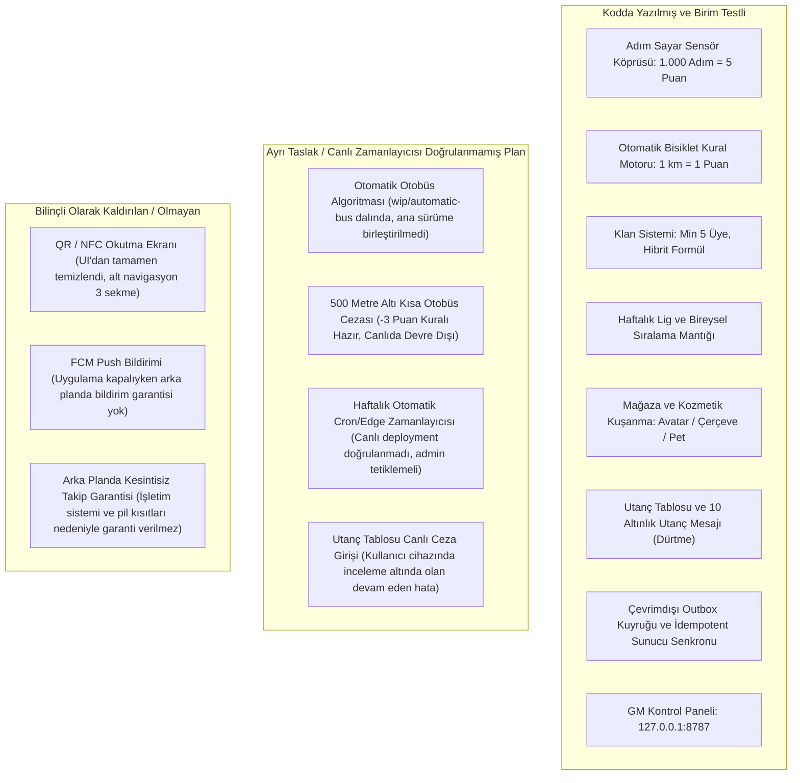
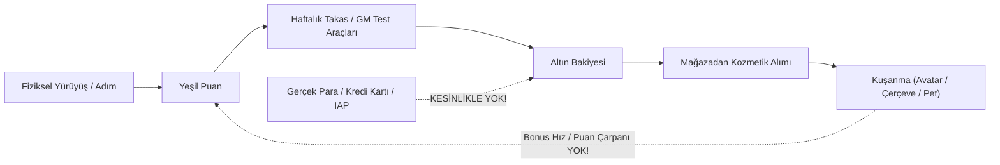
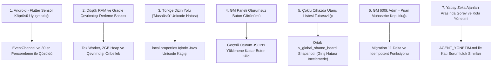

# Yeşil Adım — Proje Fikriyatı, Gerçek Yetenekler, Sınır Durumları ve Mühendislik Raporu

Bu belge, **Yeşil Adım** projesini ilk kez dinleyecek olan bir jüriye / ders sorumlusu hocaya sunum yaparken rehberlik etmek üzere hazırlanmıştır. Projenin neden var olduğu (fikriyatı), sistemin arkasındaki motivasyon ve sürdürülebilirlik mekanizmaları, kod düzeyinde yazılmış kurallar, henüz plan aşamasında olan kısımlar, karşılaşılan kritik sınır durumları (edge cases) ve ilk kez böyle bir hibrit mobil sistem geliştirilirken bizzat karşılaşılan gerçek mühendislik zorlukları dürüstçe belgelenmiştir.

> [!IMPORTANT]
> **Dürüst Mühendislik İlkesi:** Bu sunum belgesinde pazarlama ifadelerine, şişirilmiş vaatlere veya çalışmayan özellikleri çalışıyormuş gibi göstermeye yer verilmemiştir. Gerçekte çalışan, birim testlerle doğrulanan, taslakta bırakılan, donanım teyidi henüz yapılmamış ve bilinçli olarak devre dışı bırakılan unsurlar birbirinden açıkça ayrılmıştır.

---

> **Son test yolu:** Telefonda demo senaryosu sunucuya ceza yazmaz. Migration 12 canlıya uygulandı; PC GM panelinde kullanıcı seçip “Araba/Taksi Cezası Ekle” ile ortak listeye test kaydı eklenebilir. Ayrı “Utanç Test Bildirimi Gönder” düğmesi yönetici bildirimi yollar; altın harcayan oyuncu mesajından ayrıdır. Yeni APK kuruldu; iki fiziksel cihaz ve bildirim teslimi elle kontrol edilecek.

## 1. Açık Sözlük (Jargonsuz, Günlük Hayattan Benzetmeler)

Hocanın sunumu dinlerken teknik terminolojiye takılmaması için projede geçen temel kavramların en sade karşılıkları:

| Teknik Terim | Sade Anlamı | Günlük Hayattan Benzetme |
|---|---|---|
| **Sensör (Sensor)** | Telefonun içindeki fiziksel ölçüm donanımı | Telefonun gözü ve kulağı: adım sayacı, ivmeölçer (sallantı), GPS (konum). |
| **Kotlin Köprüsü** | Android işletim sistemi ile Flutter arayüzünü konuşturan mini tercüman | Flutter doğrudan donanıma dokunamaz. Android "şu an 1000 adım atıldı" der, köprü tercüme edip Dart'a iletir. |
| **Store (`AppStore`)** | Uygulamanın anlık hafızası, muhasebecisi ve karar merkezi | Dükkanın kasası ve defteri: Adım, puan, altın, lig ve klan verileri burada tutulur. |
| **Outbox (Giden Kutusu)** | İnternet yokken sunucuya gidecek işlemleri telefonda bekleten kuyruk | Postaneye gidemeyince mektupları masanın çekmecesinde sıraya dizip bekletmek. |
| **Supabase** | Ortak bulut veritabanı ve sunucu fonksiyonları merkezi | Üniversitenin ortak dijital duyuru ve sınav sonuç panosu. |
| **RPC (Stored Procedure)** | Sunucuda çalışan ve doğrudan veritabanını güncelleyen güvenli fonksiyon | Banka gişesi: Müşteri kasaya elini sokamaz, talebini gişe memuruna verir; işlemi memur yapar. |
| **RLS (Satır Düzeyi Güvenlik)** | Veritabanında "bu satırı kim görebilir ve kim değiştirebilir" kuralı | Herkes ortak skor listesini okuyabilir; ancak kimse başkasının altınını veya puanını değiştiremez. |
| **Anonim Giriş (Anonymous Auth)** | Şifre, e-posta veya telefon numarası istemeden cihaza özel tekil anahtar atanması | Konser kapısında isim sormadan kola takılan barkodlu bileklik. |
| **Idempotency (Tekrarın Etkisizliği)** | Aynı işlem komutunun iki kez gitmesi durumunda ikinci kez işlem yapılmaması | Asansör çağırma düğmesine 10 kez üst üste bassanız bile asansörün yalnız bir kez gelmesi. |
| **GM (Game Master) Paneli** | Geliştiricinin veya jürinin senaryoları simüle etmek için kullandığı kumanda masası | Simülatör kontrol odası: Adım ekleme, haftalık ligi kapatma gibi test araçları. |

---

## 2. Sorun (Problem)

Modern kent yaşamında insanlar 500 metre - 1 kilometre gibi rahatlıkla yürünebilecek veya bisikletle gidilebilecek çok kısa mesafeleri dahi alışkanlık, tembellik ya da zaman baskısı nedeniyle motorlu araçlarla (özel otomobil, taksi vb.) katetmektedir. 

Bu durumun üç temel sonucu vardır:
1. **Bireysel Sağlık Kaybı:** Hareketsiz yaşam tarzı, kardiyovasküler problemler ve fiziksel kondisyon kaybı.
2. **Kentsel Karbon Salımı ve İsraf:** Kısa mesafelerde motor henüz ideal çalışma sıcaklığına ulaşmadığı için kilometre başına salınan CO₂ ve fosil yakıt israfı en üst seviyeye çıkar.
3. **Farkındalık Boşluğu:** İnsanlara sadece "Çevre için yürümelisin" demek soyut kalmakta, anlık davranış değişikliği yaratmamaktadır. Davranışı dönüştürmek için ölçülebilir, şeffaf ve somut bir neden gerekmektedir.

---

## 3. Çözüm (Solution)

**Yeşil Adım**, kullanıcının cebindeki telefonun yerleşik sensörlerini (adım sayar donanımı, ivmeölçer ve GPS) kullanarak fiziksel hareketi takip etmeye çalışan, çevreci ulaşımı puanlayıp ödüllendiren, motorlu taşıt israfını ise oyunlaştırılmış sosyal dinamiklerle yüzleştiren hibrit bir mobil sistemdir.

Sistem şu kurallar etrafında tasarlanmıştır:
- Kullanıcı yürüdükçe telefon adımları sayar. Tamamlanan her **1.000 adım = 5 Yeşil Puan** kazandırır.
- Kullanıcı bisiklete bindiğinde sistem GPS hızı ve ivme titreşimlerinden bisiklet profilini tahmin eder; her **1 km = 1 puan** verir.
- Puanlar haftalık ligde toplanır; hafta kapanışında bire bir oranda **Altına** dönüştürülmesi hedeflenir.
- Biriken altınlarla uygulama içi mağazadan avatar, profil çerçevesi ve dijital çevre dostu evcil hayvanlar (pet) edinilir.
- Kısa mesafede araba/taksi tercih eden kullanıcı tespit edilirse bu durum puanını silmez; ancak harcanan tahmini karbon miktarı **"Utanç Tablosu"** siciline yazılır.

---

## 4. Özellikler (Mevcut Durum Matrisi)

Sunumda hocaya neyin tam olarak çalıştığını, neyin taslak olduğunu ve neyin bilinçli olarak kaldırıldığını net bir şekilde ifade etmek gerekir:



---

## 5. Fikriyat ve Ürünün Neden Var Olduğu

Çoğu çevre koruma uygulaması yalnızca istatistik sunan "pasif sayaçlar" olmaktan öteye gidememektedir. İnsan psikolojisi ise soyut küresel iklim krizini günlük kararlarıyla doğrudan bağdaştıramaz ("Ben bugün 1 km yürüsem kutup ayıları kurtulacak mı?").

Yeşil Adım'ın varoluş felsefesi:
- **Mikro Eylemleri Görünür Kılmak:** 1.000 adım veya 1 kilometrelik bir bisiklet sürüşü küçük görünebilir; ancak haftalık yarışmada klanın kaderini değiştiren bir puana dönüştüğünde birey eyleminin değerini hisseder.
- **Şeffaf Geri Bildirim:** Kullanıcıya "bugün çevreye 0,19 kg CO₂ kazandırdın" veya "arabaya binerek 0,38 kg CO₂ israf ettin" dendiğinde davranışın çevreye tahmini maliyeti somutlaşır.
- **Yerel ve Topluluk Odaklılık:** Birey tek başına yürümekten sıkılabilir; fakat üniversite kampüsündeki arkadaşlarıyla oluşturduğu klanın sıralamasını yükseltmek için bir durak önce inip yürümeyi tercih eder.

---

## 6. Rekabetçilik Duygusu ve Sağlıklı Rekabet

Rekabet oyunlaştırmanın en güçlü motorudur; ancak kontrolsüz bırakılırsa toksik bir ortama, hileye veya kullanıcıların küsüp uygulamayı terk etmesine yol açar. Yeşil Adım'da rekabet şu tasarım prensipleriyle dengelenir:

1. **Lig Kademeleri (CO'dan BIO'ya):** 
   Kullanıcılar tek bir devasa havuza atılmaz. Bireysel puana göre 6 farklı lig kademesi tanımlanmıştır: `CO (0-149)` -> `CO₂ (150-349)` -> `N₂ (350-649)` -> `O₂ (650-1099)` -> `O₃ (1100-1799)` -> `BIO (1800+)`. Yeni başlayan biri en tepedeki maratoncuyla değil, kendi seviyesindekilerle yarışır.
2. **Ceza Sisteminde Pozitif Denge (Puan Gaspı Yok):**
   Araba veya taksiyle tespit edilen bir kullanıcının o güne kadar alın teriyle yürüdüğü adımların puanı elinden **alınmaz**. Yalnızca israf ettiği tahmini karbon Utanç Tablosu'na yazılır. Bu sayede kullanıcı "bütün emeğim yandı" diyerek uygulamayı terk etmez.
3. **Maskeli Utanç Tablosu:**
   Sosyal baskı bir şaka ve tatlı bir rekabet unsurudur, bir linç aracı değildir. Utanç tablosunda isimler `Ahmet***`, `Mehmet***` şeklinde maskelenir ([name_masker.dart](../lib/core/utils/name_masker.dart)).
4. **Haftalık Döngü (Plan / Manuel Tetikleme):**
   Haftalık döngü tamamlandığında puanların altına dönüştürülmesi ve ligin sıfırlanması hedeflenir. Bu sayede yeni haftada herkes eşit başlar. Ancak bu işlem şu an canlıda otomatik bir Cron job olarak değil, yönetici/GM fonksiyonu üzerinden tetiklenmektedir.

---

## 7. Motivasyon Mekanizması

Kullanıcının uygulamayı her gün açmasını sağlayan motivasyon üçlüsü:

1. **Anlık Geri Bildirim (Dopamin Döngüsü):**
   Ana sayfada yer alan dinamik sayaç: *"Sonraki +5 puana 340 adım kaldı!"* Kullanıcı bu mesajı gördüğünde asansöre binmek yerine merdivenleri çıkarak 340 adımı tamamlamak ister.
2. **Seri (Streak) Gururu:**
   Günde 6.000 adımı tamamlayan kullanıcı günlük serisini (+1 gün) artırır. Serisini 15 güne çıkaran bir kullanıcı, zinciri kırmamak için akşam saatinde yürüyüşe çıkmayı alışkanlık haline getirir.
3. **Kalıcı Statü Sembolleri (Kozmetikler):**
   Kazanılan puanlar ve ödüller altına dönüştüğünde, kullanıcı mağazadan "Ozon Perisi Aura" veya siber arı "Bit-Bee" evcil hayvanını ya da "Oksijen Neon Çerçevesi"ni alıp profiline kuşanır. Sıralama listesinde bu kozmetiklerle görünmek arkadaş grubunda bir tatlı rekabet unsurudur.

---

## 8. Sürdürülebilirlik ve Karbon (CO₂) Tahmin Modeli

> [!CAUTION]
> **Hocaya Karşı Bilimsel İddia Uyarısı:**
> Uygulamadaki CO₂ tasarruf ve israf değerleri fiziksel bir egzoz sensörü ölçümü **değildir**. Literatürdeki ortalama kentsel binek araç emisyon katsayılarına dayanan **tahmini bir matematiksel simülasyon modelidir**. Hocaya sunum yaparken "arabanın egzozunu ölçüyoruz" denmemeli, "ortalama emisyon katsayısıyla farkındalık hesabı yapıyoruz" denmelidir.

Formülasyon Esasları:
- **Araba / Taksi İsraf Katsayısı:** Kilometre başına **`0,192 kg CO₂`** (ortalama benzinli/dizel şehir içi araç salımı).
- **Yürüyüş ve Bisiklet Tasarruf Katsayısı:** Araç yerine yürünen her kilometre için **`0,190 kg CO₂`** atmosfere salınmamış kabul edilir.
- **Ağaç Eşdeğeri:** Profil ekranında gösterilen ağaç kurtarma göstergesi eğitsel bir demo modelidir.

---

## 9. Klan Sistemi ve Hibrit Denge

Klan sistemi, bireysel çabayı takım ruhuna dönüştürür. Ancak oyun dünyasındaki klasik klan sistemlerinde büyük bir adaletsizlik yaşanır: Çok üyesi olan kalabalık klanlar, üyeleri hiç yürümeseler bile sırf sayı üstünlüğüyle zirveye otururlar.

Yeşil Adım bu adaletsizliği **Hibrit Normalizasyon Formülü** ile çözmüştür:

### 1. Minimum 5 Üye Barajı
Klanın sıralamaya girebilmesi için bünyesinde **en az 5 üye** bulunmalıdır ([clan.dart](../lib/models/clan.dart#L19)). 1-2 kişilik sahte klanların sistemi manipüle etmesi engellenir.

### 2. Hibrit Normalizasyon Formülü
```text
Klan Skoru = (Toplam Puan × 0,6) + (Üye Başına Ortalama Puan × 50 × 0,4)
```

**Somut Örnek:**
- **A Klanı (Küçük ve Çok Aktif):** 5 üyesi var, toplam 1.000 puan toplamışlar.
  - Ortalama: 1000 / 5 = 200 puan.
  - Skor: `(1.000 × 0,6) + (200 × 50 × 0,4) = 600 + 4.000 = 4.600 Puan`.
- **B Klanı (Kalabalık ama Tembel):** 10 üyesi var, toplam 1.000 puan toplamışlar.
  - Ortalama: 1000 / 10 = 100 puan.
  - Skor: `(1.000 × 0,6) + (100 × 50 × 0,4) = 600 + 2.000 = 2.600 Puan`.

*Sonuç:* Aynı toplam puana sahip olmalarına rağmen, az üyeli fakat bireysel ortalaması yüksek olan A Klanı yarışta belirgin şekilde öne geçer!

### 3. Rol Yapısı ve Klansız Durum
- **Roller Puana Bağlı Değildir:** Klan liderliği veya üyeliği haftalık puana göre kendiliğinden el değiştirmez; veritabanında kullanıcının gerçek profiline bağlıdır (`clan_role: 'leader' | 'member'`).
- **Klansız Durum:** Bir klan seçmeyen kullanıcı bireysel ligde, mağazada ve Utanç Tablosu'nda yer almaya devam eder; sadece klan sıralaması yarışına dahil edilmez.

---

## 10. Kozmetik Altyapısı ve İktisadi Denge (Pay-to-Win Karşıtlığı)

Uygulama içi mağazada yer alan ürünler kodda ve demo veritabanında tanımlıdır ([demo_data.dart](../lib/data/demo_data.dart), [shop_item.dart](../lib/models/shop_item.dart)):

- **Evcil Hayvanlar (Petler):**
  - **Yürüyen Çam Fidanı** (`pet_pine_sprout`): Adım attıkça büyüyen fidan teması.
  - **Bit-Bee** (`pet_robo_bee`): Profilde uçuşan biyo-mekanik siber arı.
  - **Ozon Perisi Aura** (`pet_leaf_fox`): Karadeniz yaylalarının temiz havasını simgeleyen parıltılı yoldaş (önceki prototipteki tilki modelinin güncel halidir).
- **Profil Çerçeveleri:** **Oksijen Neon Çerçevesi** (`frame_oxygen_glow`), **Ozon Kalkanı Çerçevesi** (`frame_ozone_purple`), **Sönmez Biyosfer Tacı** (`frame_biosfer_gold`).
- **Avatarlar:** **Kaçkar Dağcısı** (`ava_ktu_mountaineer`), **Aero Bisikletçi** (`ava_cycling_pro`).



### Pay-to-Win Neden İmkansızdır?
1. **Gerçek Para ile Satış Yoktur:** Uygulama içinde kredi kartı, Google Play ödemesi veya mikro-ödeme kapısı bulunmamaktadır. Altın yalnızca haftalık puan takasından, GM/debug komutlarından veya test bonuslarından elde edilir; parayla satın alınamaz.
2. **Kozmetikler Safi Görseldir:** Bir çerçeveyi veya evcil hayvanı kuşanmak kullanıcıya fazladan adım puanı, hız çarpanı veya sıralama avantajı **sağlamaz**. Kodda kozmetiklerin puana etki ettiği tek bir satır dahi yoktur.
3. **Mahremiyet ve RLS Koruması:** Kullanıcının hangi kozmetiklere sahip olduğu (`user_inventory`) ve mevcut altın bakiyesi sunucu düzeyinde RLS politikalarıyla korunur; sıralama tablolarında üçüncü şahıslara teşhir edilmez.

---

## 11. Ceza Sistemi: Gerçek Kaynak Kod ve Donanım Doğrulaması

Projede "ceza sistemi"nin ne olduğu ve ne olmadığı konusunda jüriye en dürüst açıklamayı yapmak zorundayız:

| Ceza Mekanizması | Kod Durumu | Canlı Donanım Doğrulaması | Gerçek Çalışma Biçimi |
|---|---|---|---|
| **Araba / Taksi Cezası** | [activity_validation_service.dart](../lib/services/activity_validation_service.dart#L115-L120) | **Kod var; donanım doğrulaması yok** | Hız > 30 km/sa ve adım ≤ 10 ise israf edilen tahmini CO₂ Utanç Tablosu'na yazılır. **Altın veya puan kesintisi yapılmaz.** |
| **Bisikleti Arabayla Taklit Etme** | [activity_validation_service.dart](../lib/services/activity_validation_service.dart#L85-L89) | **Kod var; donanım doğrulaması yok** | Ortalama hız > 25 km/sa iken ivme varyansı < 0,12 ise (araba süspansiyonu şüphesi) bisiklet puanı verilmez, Utanç Tablosu'na yönlendirilir. |
| **Kısa Otobüs Cezası (≤ 500m)** | [auto_transport_classifier.dart](../lib/services/auto_transport_classifier.dart#L183-L196) | **Devre Dışı (Canlıda kapalı)** | 500 metrenin altında otobüse binilirse -3 puan kesilmesi kuralı ve birim testi mevcuttur; ancak otobüs akışı canlıda açılmadığı için **ceza aktif değildir**. |
| **Toplu Taşıma 45 Dk Kuralı** | [activity_validation_service.dart](../lib/services/activity_validation_service.dart#L111-L114) | **Kod var; muafiyet kuralı** | Son 45 dakika içinde geçerli bir toplu taşıma kaydı varsa, hız yüksek çıksa bile kullanıcıya ceza yazılmaz (muafiyet). |
| **QR / NFC Biniş Doğrulama** | UI Kaldırıldı | **Yok (Arayüzden silindi)** | QR/NFC ekranı alt gezinme çubuğundan kaldırılmıştır (`bdbffba`). Navigasyon 3 sekmedir. |

> [!WARNING]
> **Utanç Tablosu Girişi Devam Eden Hata Notu:**
> Kullanıcının son fiziksel testlerinde arabayla seyahat veya ceza simülasyonu yapılmasına rağmen **Utanç Tablosu'na girilemediği** bildirilmiştir. Migration 11 ile sunucu tarafındaki `v_global_shame_board` görünümü ve bağımsız sorgu yapısı kurulmuş olsa da; istemcinin ceza olayını göndermesi (`recordVehiclePenalty`) ile sunucunun bunu Utanç Tablosu'na işlemesi arasındaki zincirde bir kopukluk olduğu tespit edilmiştir. Bu akış şu an aktif inceleme altındadır; dolayısıyla sunumda "utanç tablosuna giriş sorunu tamamen çözüldü" denmemeli, hata araştırılıyor denmelidir.

---

## 12. Kritik Sınır Durumları (Edge Cases) Karşılaştırma Tablosu

Sistem sınır durumlarında çökmek yerine eldeki veriye göre zarifçe (graceful degradation) davranmaktadır:

| Sorun Alanı | Somut Örnek Senaryo | Nasıl Ele Alınıyor? (Şu Anki Kod) | Sınır veya Eksik (Nerede Tıkanır?) | Hocaya Anlatılacak 1 Cümle |
|---|---|---|---|---|
| **Sensör İzni Ret** | Kullanıcı ilk açılışta fiziksel aktivite veya konum iznini vermedi. | Köprü `false` döner; uygulama çökmez, adım/bisiklet özellikleri sessizce bekler, ayarlar uyarısı gösterilir. | Sensörsüz adım ölçülemez; puan kazanılamaz. | "İzin verilmediğinde uygulama çökmez, o sensöre bağlı özellikleri zarifçe kapatır." |
| **Sonradan İptal** | Kullanıcı yürüyüşün ortasında Android ayarlarından konum iznini kapattı. | GPS gerektiren fonksiyonlar `null` veri alır; `checkSteps` GPS yoksa konumu 0 metre varsayıp kullanıcıyı suçlamaz. | Bisiklet modu hız ölçemediği için otomatik sonlanır. | "Kullanıcı izni sonradan kapatsa dahi sistem veri eksikliğini kullanıcı aleyhine ceza olarak kullanmaz." |
| **Telefon Kilidi & Arka Plan** | Telefon cepte, ekran kilitli, kullanıcı 2 km yürüdü. | Sayaç sistemi Kotlin tarafında event fırlatır; ancak kilit altındayken Android pili korumak için CPU'yu uyutabilir. | İşletim sistemi sensör akışını keserse adımlar ekran açılana kadar toplu birikebilir veya kaçabilir. | "Gerçek cihazlarda tüm koşullarda tam takip garantisi yoktur; ekran açıkken de donanım ve işletim sistemi sınırlarına tabidir, arka planda ise takip garantisi verilmez." |
| **Uygulama Kapalıyken Bildirim** | Kullanıcıya admin tarafından bildirim veya utanç mesajı yollandı. | Firebase Cloud Messaging (FCM) altyapısı kurulu değildir; yalnızca uygulama açıkken yerel in-app bildirim düşer. | Uygulama kapalıysa telefonun bildirim çubuğunda anlık uyarı çıkmaz. | "FCM gibi harici bildirim sunucuları entegre edilmediğinden uygulama kapalıyken anlık uyarı garantisi yoktur." |
| **Adım Eşiği (999 vs 1000)** | Kullanıcı 999 adım attı, sonra 1 adım daha atıp 1.000 oldu; 1.999'a kadar yürüdü. | 999 adımda 0 puan; 1.000'de +5 puan yazılır. 1.001 - 1.999 arasında puan artmaz; 2.000'de tekrar +5 puan verilir. | Puan küsuratlı (örneğin 2,5 puan) verilmez; yalnız binlik tamamlama esastır. | "Adım puanı kesintili bir merdiven fonksiyonudur; ödül yalnız tam binlik eşikler aşıldığında tetiklenir." |
| **Telefonu Sallama Hilesi** | Kullanıcı koltuğa oturup telefonu deli gibi sallayarak adım kasmaya çalışıyor. | Dakikada 185 adımdan yüksek kadans veya >3,5 Hz titreşim varken GPS konumu 3 metreden az değişmişse tespit edilir ve reddedilir. | Kullanıcı telefonu yürüyüş hızında (dakikada 100 sallama) ve çok düzenli sallarsa sensör bunu adımdan ayıramaz. | "Aşırı hızlı ve hareketsiz sallamalar filtrelenir; ancak düşük frekanslı yapay sallamalar donanımsal bir sınırdır." |
| **GPS Zayıflığı / Tünel** | Kullanıcı tünelden geçiyor veya metroda; GPS hassasiyeti 45 metreye fırladı. | `gpsAccuracyMeters > 30m` ise araba veya bisiklet kararı verilmez; sistem 'inconclusive' (belirsiz) moduna geçer ve ceza kesmez. | Tünel boyunca katedilen mesafe bisiklet veya yürüyüşe eklenemez. | "GPS hassasiyeti 30 metrenin altına düştüğünde sistem masumiyet karinesini uygulayarak kimseyi cezalandırmaz." |
| **Araba vs Otobüs & Yolcu Durumu** | Kullanıcı otobüste, dolmuşta veya arkadaşının arabasında yolcu olarak gidiyor. | Hız 35 km/sa, adım artışı az. Toplu taşıma canlıda kapalı olduğundan sistem araba/taksi eşiğini görebilir. | Telefon cepteyken kişinin direksiyonda mı yoksa yolcu mu olduğunu donanım bilemez. | "Telefon sensörü kişinin yolcu mu sürücü mü olduğunu bilemez; bu donanım sınırı nedeniyle ceza puan silmez, sadece tahmini CO₂ farkındalığı üretir." |
| **İnternet Kopması & Outbox** | Kullanıcı ormanda internetsiz yürüyüş yaptı ve 3.000 adım attı. | Olaylar yerel hafıza giden kutusuna (`outbox`) tekil `eventId` ile yazılır. İnternet gelince kuyruk sırayla sunucuya boşaltılır. | 5 kez üst üste sunucu hatası alan olay karantinaya alınır. | "Outbox mimarisi sayesinde internet olmasa bile adımlar kaybolmaz, ilk bağlantıda sunucuya güvenle aktarılır." |
| **Aynı Olayın Çift Puan Riski (Retry)** | Zayıf 3G bağlantısında istek sunucuya ulaştı ama yanıt telefona dönemedi; telefon tekrar yolladı. | Sunucudaki `processed_events` tablosu `eventId`'yi kontrol eder. İkinci istekte puan üretilmez, önceki başarılı yanıt döner (Idempotency). | İstemcinin her sefere aynı eventId ile gitmesi şarttır. | "İdempotent mimari sayesinde zayıf şebekede mükerrer giden istekler asla ikinci kez puan kazandırmaz." |
| **GM 600k Adım Puanı Bug'ı** | GM panelinden kullanıcıya 600.000 adım set edildiğinde puan sıfır kalıyordu. | **Düzeltildi (Migration 11):** Sunucu muhasebesi `(new_steps / 1000 * 5) - already_awarded` formülüne bağlandı. 600k adım doğrudan +3.000 puana çevrildi. | `add_steps` için 100k sınırı vardır; 600k gibi devasa sayılar için `set_steps` kullanılır. | "Geçmişte yaşanan adım-puan muhasebe kopukluğu atomik delta fonksiyonuyla onarılmış ve çift ödül riski kapatılmıştır." |
| **Aynı Değerle Sıfırlama** | Kullanıcının adımı 600k iken yönetici yanlışlıkla tekrar 'Adım Ayarla 600k' butonuna bastı. | Sunucu `delta = 0` hesaplar; `points_delta = 0` döner. Kullanıcıya fazladan 1 puan dahi eklenmez. | Yok; tam idempotenttir. | "Aynı adım sayısına tekrar basıldığında sistem durumu korur, mükerrer puan üretmez." |
| **Utanç Listesi Senkronizasyonu** | 1. telefonda utanç listesinde farklı, 2. telefonda sahte demo isimler görünüyordu. | Sunucu tarafında `v_global_shame_board` görünümü oluşturuldu; istemcinin yerel demo listesine geri düşüşü engellendi. | Kullanıcı canlıda utanç tablosuna giremediğini raporlamıştır; bu hata şu an aktif inceleme altındadır. | "Ortak sunucu görünümü kurulmuştur ancak cezanın listeye düşme akışındaki aksaklık halen incelenmektedir." |
| **Demo Hedefe Mesaj Gönderme** | Kullanıcı Utanç Tablosu'nda gördüğü simülasyon profiline (ör. Demo Ali) utanç mesajı atmaya çalıştı. | Sunucu `v_target.is_demo = true` kontrolü yapar; isteği reddeder. Kullanıcının 10 altını **harcanmaz**. | Simülasyon profillerine mesaj iletilemez. | "Sanal demo profillerine mesaj gönderilmesi engellenmiş, kullanıcının altınının boşa gitmesi önlenmiştir." |
| **Utanç Mesajı Sınırları** | Kullanıcı arka arkaya onlarca küfürlü mesaj yollamak veya altınını harcamak istedi. | Mesaj en fazla 50 karakterdir; 10 altın gerektirir; İstanbul takvim gününde en fazla 1 kez atılabilir; kendine atılamaz. | Kötü niyetli kelimeleri engelleyen bir yapay zeka içerik moderatörü şu an yoktur. | "Utanç mesajı spam ve tacizi önlemek için 50 karakter ve günde 1 adetle sıkı şekilde sınırlandırılmıştır." |
| **Kota Sıfırlama** | Test sırasında kullanıcının günlük 1 mesaj kotası doldu ve test tıkandı. | GM panelindeki veya SQL'deki `rpc_admin_reset_shame_quota` fonksiyonu yetkili yönetici tarafından çağrılarak kota sıfırlanabilir. | Sıfırlama yalnız admin yetkisiyle mümkündür. | "Geliştirme ve test süreçleri için yöneticiye anlık kota sıfırlama mekanizması sağlanmıştır." |
| **Haftalık Döngü Zamanlaması** | Pazar gecesi puanların altına dönüşmesi ve ligin sıfırlanması beklentisi. | SQL fonksiyonu (`rpc_admin_trigger_weekly_reset`) mevcuttur; yönetici panelden tetikleyebilir. | Canlıda otomatik Cron / Edge Function zamanlayıcısı root tarafından doğrulanmamıştır; otomatik plan durumundadır. | "Haftalık takas altyapısı kodda hazırdır ancak otomatik zamanlayıcı henüz canlıda doğrulanmamıştır." |
| **Cihaz Sıfırlama / Anon Kimlik Kaybı** | Kullanıcı uygulamayı sildi veya telefonun verilerini temizledi. | Anonim kimlik telefondaki güvenli hafızada saklandığı için silinir; sunucu yeni açılışta yeni bir kullanıcı üretir. | Eski altınlar, puanlar ve envanter kurtarılamaz. | "Anonim giriş kullanıcı mahremiyetini korur; ancak uygulama silinirse hesap kurtarma e-postası yoktur." |
| **Ücretsiz Sunucu Kotası** | Sınıftaki 40 öğrenci aynı anda uygulamayı açıp saniyede 10 konum isteği yolladı. | Supabase ücretsiz katmanı (free tier) bağlantı havuzunu (connection pool) tüketebilir veya kota aşımı nedeniyle istekleri yavaşlatabilir. | Kurumsal yüksek yük (100.000+ kullanıcı) henüz bu altyapıyla test edilmemiştir. | "Proje ders kapsamındaki prototip yükler için optimize edilmiştir; devasa kitleler için kurumsal altyapı gerekir." |

---

## 13. Adalet, Etik ve Kullanıcı Güvenliği

Bir yazılım mühendisliği projesinde yalnızca kodun çalışması değil, insan hayatına ve etiğe dokunan yönleri de değerlendirilmelidir:

1. **Zorunlu Araç Kullanımı, Engellilik ve Sağlık Durumları:**
   Kullanıcının bedensel engeli, yürümesini engelleyen geçici bir sakatlığı, kucağında bebeği veya acil bir sağlık durumu olabilir. Cepteki telefon kişinin bu insani bağlamını anlayamaz. Bu sebeple algoritma yüksek hız yakaladığında **kullanıcının alın teriyle yürüdüğü adımların puanını veya altınını KESMEZ**. Yalnızca tahmini karbon miktarı farkındalık amacıyla kaydedilir. Gelecekte tekerlekli sandalye kullanımını ivmeölçerle tanıyan ayrı bir erişilebilirlik modu planlanmaktadır.
2. **Kullanıcı Güvenliği (Trafikte Ekran Kullanımı):**
   Kullanıcının bisiklet sürerken ekrana bakıp dikkatini dağıtmaması için sürüş bitiminde 45 saniyelik durağanlık eşiğiyle oturumu tamamlama tasarlanmıştır; ancak bu arka planda kesintisiz sensör garantisi anlamına gelmez, hareket algılama sensör eşiklerine dayalı bir tahmindir.
3. **Utanç Mesajı ve Akran Zorbalığı (Mobbing):**
   Utanç tablosundaki kişiye 10 altın karşılığında "Neden arabaya bindin, biraz yürü!" mesajı gönderme özelliği mizahi bir motivasyon aracıdır. Ancak kötü niyetli kullanımda kırıcı olabilir. Bu nedenle sistemde:
   - Mesaj boyutu **50 karakterle** sınırlandırılmıştır.
   - Günde **en fazla 1 mesaj** kotası konmuştur.
   - İsimler maskelenmiştir (`Ahmet***`).
   - Gelecek sürüm için küfür/hakaret filtreleme kütüphanesi öngörülmektedir.
4. **Veri Mahremiyeti (Ham GPS Saklanmaması):**
   Sunucuya kullanıcının evinin veya okulunun açık koordinatları kaydedilmez. Sunucuya yalnızca mesafenin büyüklüğü (örneğin "1.2 km yürüdü") gönderilir. Ham rota çizgisi sunucu veritabanında saklanmaz.

---

## 14. Geliştirme Sürecinde Gerçekten Yaşanan Mühendislik Sorunları vs. Öngörülen Sorunlar

Bu bölüm, projeyi bizzat geliştiren mühendisin yaşadığı gerçek deneyimi yansıtır. Yaşanmamış kurgusal sorunlar yerine, log kayıtlarında sabit olan 7 somut problem anlatılmalıdır:



### Gerçekten Yaşanan 7 Somut Mühendislik Sorunu

1. **Android - Dart Sensör Köprüsü Uyuşmazlığı:**
   Android işletim sistemi adım sayar donanımından gelen verileri anlık değil, toplu paketler halinde fırlatabilmektedir. Flutter tarafında bu akış doğrudan UI'a bağlandığında arayüz kilitlenmeleri yaşandı. Çözüm olarak Kotlin tarafında bir donanım köprüsü ([MainActivity.kt](../android/app/src/main/kotlin/com/yesiladim/ecoclan/green_project/MainActivity.kt)), Dart tarafında ise verileri 30 saniyelik pencerelerde toplayıp süzen `SensorController` mimarisi kuruldu.
2. **Derleme Ortamındaki RAM Baskısı ve Çevrimdışı Kısıtlar:**
   Geliştirme makinesinde kullanılabilir RAM zaman zaman kritik seviyelere (2 GB altına) düştü. Gradle'ın paralel derleme ve arka plan daemon süreçleri işletim sistemini kilitleme noktasına getirdi. Katı kural kondu: `Gradle --offline --no-daemon --max-workers=1`, JVM heap en çok 2 GB. Derlemeler tek iş parçacığına indirilerek stabilite sağlandı.
3. **Türkçe Karakterli Dizin Yolu (`Masaüstü`) Krizi:**
   Proje dizini Linux ortamında `/home/girdap/Masaüstü/...` yolunda olduğu için Gradle ve Android SDK derleyicileri Türkçe `ü` karakterinde dosya yolu hatası fırlattı. Sorun, `android/local.properties` dosyasında yolun Java Unicode biçimi olan `Masa\u00fcst\u00fc` şeklinde kaçırılmasıyla (escape) çözüldü.
4. **GM Paneli Oturumsuz Buton Görünümü:**
   Sunucu tarafı RLS ve veritabanı kuralları sayesinde yetkisiz istekleri zaten reddediyordu. Ancak web arayüzlü GM paneli, tarayıcıda yönetici oturumu yüklenmeden önce de işlem düğmelerini tıklanabilir gösteriyordu (tıklanınca sunucu reddediyordu ama kafa karışıklığı yaratıyordu). Bu durum düzeltildi: Artık geçerli yönetici oturum JSON'ı panele yüklenip doğrulanana kadar tüm işlem düğmeleri kilitli tutulmaktadır.
5. **Çoklu Cihazda Farklı Utanç Listesi ve Devam Eden Giriş Hatası:**
   İki farklı telefon bağlandığında, birinci telefon sunucu verisini gösterirken, ikinci telefon sunucu listesi boş döndüğünde istemci kodundaki demo listesine (`DemoData`) geri düşüyordu. `isServerShameLoaded` kontrolü ve `v_global_shame_board` ortak sunucu snapshot'ı yazılarak yerel demo listesi ayrıştırıldı. Ancak son fiziksel testlerde kullanıcının Utanç Tablosu'na hiç giremediği tespit edilmiş olup, istemci ceza kaydı ile liste görünümü arasındaki akış halen hata inceleme kapsamındadır.
6. **GM 600.000 Adım - Puan Kopukluğu (Muhasebe Bug'ı):**
   GM panelinden bir kullanıcıya test amacıyla 600.000 adım atandığında `today_steps` artıyor fakat `weekly_points` sıfırda kalıyordu. Çünkü adım ekleme fonksiyonu ile etkinlik tablosu arasındaki muhasebe bağı kopuktu. Migration 11 ile `(new_steps / 1000 * 5) - already_awarded` formülü veritabanı fonksiyonuna gömüldü; daha önce 600k verilip 0 puanda kalan bozuk kullanıcıların tek bir çağrıyla +3.000 puana onarılması sağlandı.
7. **Yapay Zeka Destekli Geliştirmede Model Kotaları ve Görev Sınırları:**
   Geliştirme sürecinde kullanılan yapay zeka modellerinin (Claude Opus/Sonnet) günlük kotaları doldu. Görevler Gemini 3.8 Flash High modeline devredildi. Bu süreçte iki farklı yapay zekanın aynı anda aynı dosyayı düzenleyip kod çakışması üretmemesi için [AGENT_YONETIM.md](../AGENT_YONETIM.md) dosyasında yazılı kurallar ve katı görev sınırları belirlendi.

### Yaşanmamış (Ama Gelecekte Öngörülen) Sorunlar
Sunumda **asla** "milyonlarca kullanıcı sunucumuzu kilitledi" gibi abartılı ifadeler kullanılmamalıdır. Gelecek için öngörülen sorunlar şunlardır:
- **Yüksek Eşzamanlılıkta DB Kilitleri:** Binlerce kullanıcının aynı saniyede pazar gecesi saat 23:59'da adım göndermesi durumunda PostgreSQL `FOR UPDATE` satır kilitlerinde gecikme yaşanabilir.
- **Şehir Çapında Geofencing Yükü:** Trabzon veya İstanbul'daki binlerce otobüs durağının mobil cihazda poligonlarla sürekli taranması pil tüketimini artırabilir; durak kontrolünün istemci yerine sunucuya devredilmesi gerekebilir.

---

## 15. 5-10 Dakikalık Hazır Konuşma Metni (Sözlü Sunum Provası)

Bu metin, slaytlar veya uygulama gösterilirken doğrudan seslendirilebilecek doğallıkta kaleme alınmıştır:

> "Sayın Hocam, değerli arkadaşlar,
>
> Bugün sizlere kent içi sürdürülebilir ulaşımı ve fiziksel aktiviteyi oyunlaştıran projemiz **Yeşil Adım**'ı sunacağım.
> 
> Günümüzde hepimiz 500 metrelik, 1 kilometrelik mesafeleri bile üşengeçlikten ya da alışkanlıktan araba veya taksiyle gidiyoruz. İnsanlara sadece 'Çevre için yürüyün' demek bir davranış değişikliği yaratmıyor. Biz Yeşil Adım projesinde bu sorunu, cepten çıkarmak zorunda kalmadığımız telefon sensörleriyle çözmeye odaklandık.
> 
> Sistem şu temel kurallara dayanıyor: Tamamlanan her 1.000 adım kullanıcıya 5 Yeşil Puan kazandırıyor. Eğer bisiklete binerse, GPS ve titreşim sensörlerimiz bisiklet profilini tahmin ediyor ve her 1 kilometreye 1 puan veriyor. Bu puanlar bireysel ligde ve klanlarda birikiyor. Puanlar haftalık takas veya test komutlarıyla altına dönüştüğünde, kullanıcı bu altınlarla marketten çevreci avatarlar, neon çerçeveler ve Ozon Perisi Aura ya da siber arı Bit-Bee gibi dijital evcil hayvanlar edinebiliyor.
>
> Peki arabaya binenlere ne oluyor? Kimsenin emeğini çöpe atmıyoruz; alın teriyle yürüdüğü puanları silmiyoruz. Çünkü telefon cebinizdeyken aracı bizzat mı sürdüğünüzü, takside yolcu mu olduğunuzu ya da bir sağlık zorunluluğunuz mu olduğunu donanımsal olarak bilemez. Bu nedenle sistem ceza olarak puan silmez; yalnız israf edilen tahmini CO₂ miktarını bir 'Utanç Tablosu'na farkındalık sicili olarak yazar.
>
> Mühendislik tarafında en çok odaklandığımız kısım ise sistemin sınır durumlarındaki (edge cases) dayanıklılığı oldu. Örneğin kullanıcı telefonunu koltuğa oturup hızlıca sallarsa, geliştirdiğimiz algoritma dakikadaki adım frekansını ve GPS konum değişimini kıyaslayarak bu hileyi yakalıyor ve puan vermiyor. Ormanda internet koptuğunda 'Outbox' mimarimiz olayları telefonda bekletiyor, internet gelince sunucuya aktarıyor. Sunucudaki 'İdempotent' mimari sayesinde, internet kopup istek iki kez gitse dahi kullanıcıya asla çift puan yazılmıyor.
>
> Elbette dürüst bir mühendislik yaklaşımıyla eksiklerimizi ve üzerinde çalıştığımız noktaları da açıkça söylemek isteriz: Telefon donanımı araba ile otobüsü laboratuvar kesinliğinde ayıramaz; bu yüzden otobüs modülümüzü ana sürüme zorla sokmadık, ayrı bir taslak dalında tuttuk ve kimseye haksız ceza kesmemek için 500 metre altı otobüs cezasını canlıda bilerek açmadık. Ayrıca FCM gibi harici servisler kurmadığımız için uygulama kapalıyken bildirim garantisi vermiyoruz. Son fiziksel testlerimizde Utanç Tablosu'na ceza kaydının yansımasıyla ilgili bir aksaklık tespit ettik ve bu hata şu an aktif inceleme altındadır.
>
> Geliştirme sürecinde 136 birim ve entegrasyon testini başarıyla koruduk; Android köprüsünü, RAM kısıtlarını ve yönetim panelini bizzat çözdük. 
> 
> Şimdi dilerseniz uygulamamızın canlı ekranlarını ve Game Master yönetim panelini birlikte inceleyelim. Teşekkür ederim."

---

## 16. Hocadan Gelebilecek En Zor Sorular ve Kısa Dürüst Cevaplar

| Soru | Beklenen Tuzak | Kısa, Net ve Dürüst Cevap |
|---|---|---|
| **1. "Telefonu elimde sallarsam adım sayar mı, hile yapabilir miyim?"** | Sistemin hileye açık olup olmadığını test etmek. | *"Hocam, dakikada 185 adımdan hızlı veya 3,5 Hz üzerinde hareketsiz sallamaları algoritmamız yakalayıp reddediyor. Ancak bir insan telefonu yürüyüş ritminde, dakikada 90 kez çok muntazam sallarsa bunu donanımsal olarak ayıramayız; bu akıllı telefonların fiziksel sınırıdır."* |
| **2. "Arabaya bindiğimde beni belediye otobüsünden nasıl ayırt ediyorsunuz?"** | Olmayan özelliği iddia edip etmeyeceğinizi ölçmek. | *"Hocam dürüst olmak gerekirse şu an ana sürümde ayırt etmiyoruz. Otomatik otobüs algılama motorumuz ayrı bir taslak dalındadır; canlıda kullanıcıları yanlışlıkla cezalandırmamak adına kısa otobüs cezasını bilerek devre dışı bıraktık."* |
| **3. "İnternetim bittiğinde yürüdüğüm adımlar kayboluyor mu?"** | Çevrimdışı mimari bilgisini sorgulamak. | *"Hayır kaybolmuyor Hocam. İstemci tarafında 'Outbox' (Giden Kutusu) yapımız var. Adım olayları yerelde saklanır, internet geldiğinde sunucuya iletilir. Sunucudaki 'processed_events' tablosu sayesinde mükerrer gönderilse bile çift puan verilmez."* |
| **4. "Hesap oluştururken e-posta veya şifre sormadınız, hesabım çalınır mı veya kaybolur mu?"** | Anonim kimlik doğrulamanın sınırını test etmek. | *"Sistem kullanıcı gizliliğini korumak için Supabase Anonim Giriş kullanıyor. Cihaza özel tekil bir anahtar atanıyor. Ancak bunun bedeli şudur: Kullanıcı uygulamayı telefonundan tamamen silerse eski puanları geri getirilemez."* |
| **5. "CO₂ tasarruf ve israf verilerini neye göre hesaplıyorsunuz, sensörünüz mü var?"** | Bilimsel doğruluk iddiasını tartmak. | *"Hayır Hocam, fiziksel bir kimyasal sensörümüz yok. Çevre mühendisliği literatüründeki ortalama şehir içi binek araç katsayısı olan kilometre başına 0,192 kg CO₂ değerini referans alan matematiksel bir simülasyon modelidir."* |
| **6. "Parayı basan mağazadaki en iyi şeyleri alıp oyunu kazanabilir mi (Pay-to-Win)?"** | İktisadi dengeyi ve adaleti denetlemek. | *"Asla kazanamaz Hocam. Birincisi, uygulamada gerçek parayla altın alma veya kredi kartı ödemesi özelliği yoktur. İkincisi, mağazadaki eşyalar sadece çerçeve ve avatardır, puana hiçbir çarpan veya bonus sağlamaz."* |
| **7. "Klanda 50 kişi olursak 5 kişilik klanı her türlü ezer miyiz?"** | Algoritma ve normalizasyon mantığını test etmek. | *"Hayır Hocam. Klan sıralamasında 'Hibrit Normalizasyon' formülü kullanıyoruz. Skorun %40'ı üye başına düşen ortalama puana bağlıdır. 50 kişilik tembel bir klan, 5 kişilik çalışkan bir klanın çok gerisinde kalır."* |
| **8. "Geçen hafta GM panelinden 600.000 adım atandığında puan artmıyordu, o sorun neydi?"** | Sistemdeki bilinen teknik arızaya hakimiyeti ölçmek. | *"Adım güncelleme fonksiyonu ile yürüyüş etkinlik muhasebesi arasındaki SQL bağı kopuktu. Migration 11 ile atomik delta muhasebesi kurduk. Artık 600k adım doğrudan +3.000 puana çevriliyor ve mükerrer tetiklemelerde sıfır puan üretiyor."* |

---

## 17. Hızlı Çalışma Kartı (Sunum Masası / Cep Notu)

Sunuma girmeden hemen önce göz gezdirmek için özet kontrol listesi:

```text
┌────────────────────────────────────────────────────────────────────────┐
│                        YEŞİL ADIM CEP NOTU                             │
├────────────────────────────────────────────────────────────────────────┤
│ • KURAL: 1.000 Adım = 5 Puan | Bisiklet: 1 km = 1 Puan (Tahmini kural) │
│ • LİGLER: CO (0) -> CO2 (150) -> N2 (350) -> O2 (650) -> BIO (1800+)   │
│ • KLAN: Min 5 üye | Formül: (Toplam*0.6) + (Ortalama*50*0.4)          │
│ • KOZMETİK: Safi görseldir; Pay-to-Win YOKTUR; gerçek para satışı YOK. │
│ • HİLE KORUMASI: >185 adım/dk veya >3.5 Hz sallantı + 0m GPS = RET     │
│ • OUTBOX & RETRY: Her olayın tekil 'eventId'si var; çift puan imkansız│
│ • DEVRE DIŞI / EKSİK: 500m otobüs cezası KAPALI, QR/NFC UI'dan SİLİNDİ,│
│   FCM Push Bildirimi YOK, Utanç listesine giriş hatası İNCELENİYOR.   │
│ • CO2 HESABI: Araç israfı = 0.192 kg/km | Bilimsel sensör DEĞİL model! │
│ • ONARILAN BUG: GM 600k adım -> 3.000 puan delta onarımı tamamlandı.   │
│ • GM PANELİ: 127.0.0.1:8787 (8080 başka servise aittir, dokunulmaz!) │
└────────────────────────────────────────────────────────────────────────┘
```
